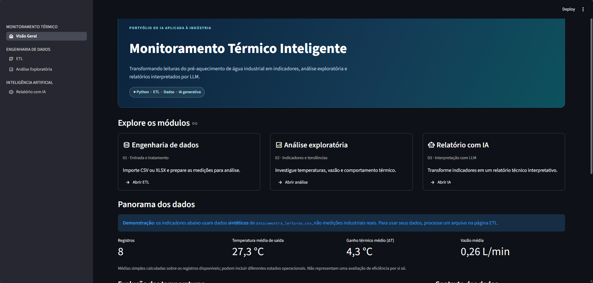
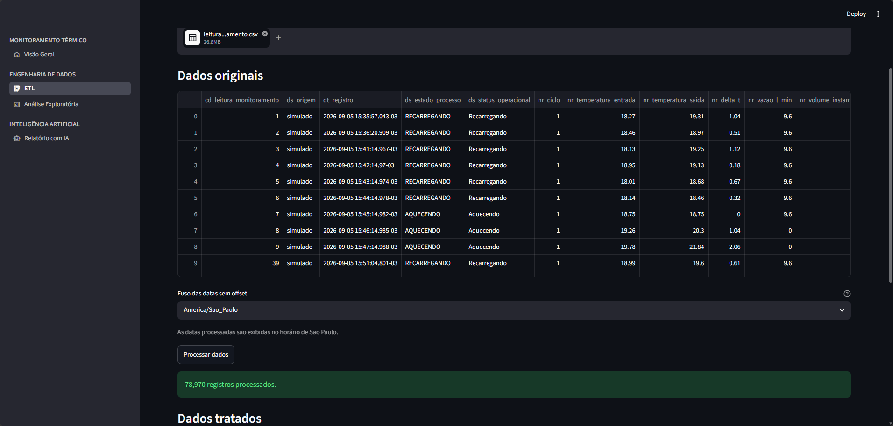
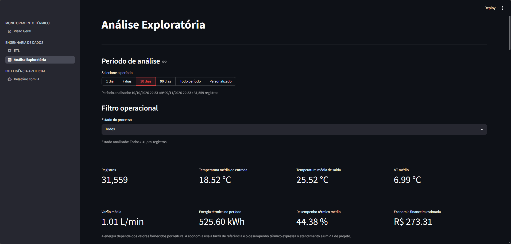
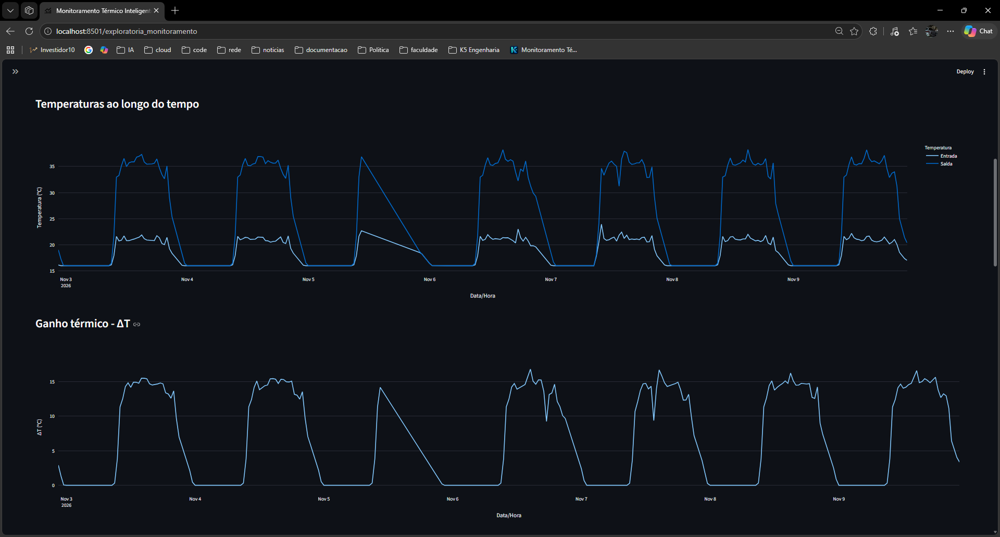
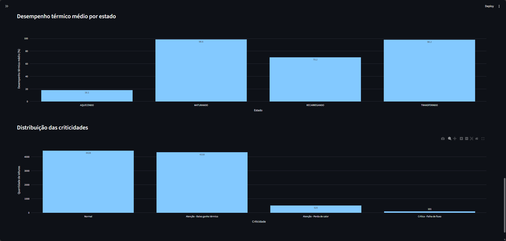
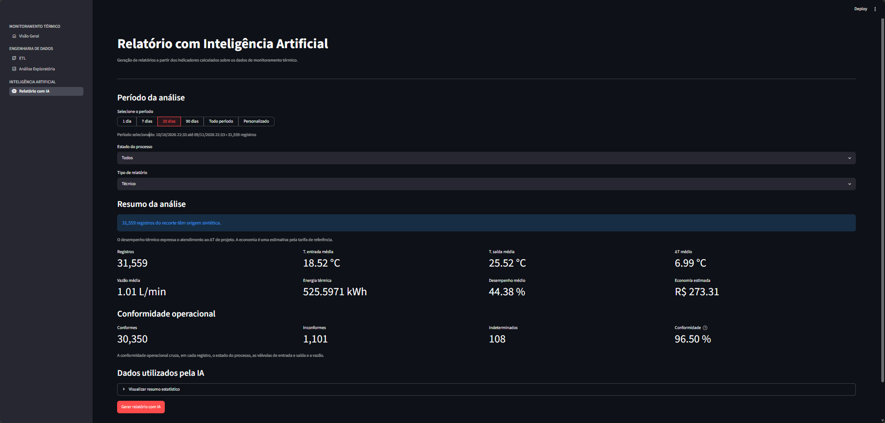
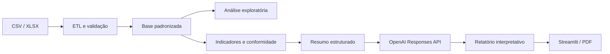

# Análise Térmica Industrial com LLM

**Do dado industrial à interpretação técnica: ETL, análise exploratória, validação operacional e relatórios assistidos por IA.**

[](https://www.python.org/)
[](https://streamlit.io/)
[](https://pandas.pydata.org/)
[](https://plotly.com/python/)
[](https://platform.openai.com/docs/)

**[Código-fonte](https://github.com/Koerichj/analise-termica-llm)** · **[Relatório técnico demonstrativo (PDF)](docs/relatorios/relatorio-tecnico-demonstracao.pdf)** · **[Projeto de monitoramento que deu origem à análise](https://github.com/Koerichj/monitoramento-termico-industrial-portfolio)**

> **Escopo:** protótipo acadêmico e de portfólio baseado em dados de **monitoramento térmico simulado**. Os indicadores são calculados pela aplicação; o modelo de linguagem interpreta um resumo estruturado. Os resultados apresentados **não demonstram desempenho, falhas ou economia de uma instalação industrial real**.

## Visão do produto

O projeto transforma leituras de pré-aquecimento de água industrial em informação analisável. A aplicação permite **importar bases CSV/XLSX, padronizar os dados, explorar tendências, verificar regras operacionais e preparar relatórios técnico, executivo ou acadêmico**, com apoio de um LLM.



*Visão geral em Streamlit. Os oito registros exibidos na página inicial pertencem à amostra sintética de demonstração; o ETL pode carregar bases maiores.*

### O que foi implementado

| Módulo | Entrega | Tecnologias |
| --- | --- | --- |
| **Engenharia de dados** | Importação CSV/XLSX, compatibilização de esquemas, datas, tipos e estados operacionais | Python, Pandas, OpenPyXL |
| **Análise exploratória** | Filtros de período/estado, métricas térmicas, gráficos e distribuições | Pandas, Plotly, Streamlit |
| **Conformidade operacional** | Verificação por registro das combinações de estado, válvulas e vazão; identificação de motivos de inconformidade | Python, Pandas |
| **Interpretação com IA** | Envio de indicadores previamente calculados para interpretação textual com instruções e ressalvas | OpenAI Responses API, prompt estruturado |
| **Relatórios** | Seleção de relatório técnico, executivo ou acadêmico e exportação em PDF | Streamlit, ReportLab |

## Demonstração com dados simulados

A captura do módulo ETL registra **78.970 leituras processadas** de uma base sintética importada. O relatório disponibilizado abaixo analisa **um recorte de 31.559 leituras**, correspondente a 30 dias. São quantidades diferentes porque representam etapas e filtros diferentes.

### 1. Importação e tratamento (ETL)



A camada de preparação aceita o esquema simplificado de demonstração e o esquema original do monitoramento. Normaliza campos como `timestamp`/`dt_registro`, `temperatura_entrada`/`nr_temperatura_entrada` e valores de válvulas. A política de datas sem indicação de fuso é configurável, evitando interpretações silenciosas.

### 2. Indicadores e recortes por período



A análise trabalha com temperatura de entrada e saída, diferença térmica (ΔT), vazão, energia **calculada**, indicador de desempenho relativo ao ΔT de referência e economia **estimada**. Valores indisponíveis devem ser identificados como `N/D`, em vez de tratados como medições existentes.

<details>
<summary><strong>Ver gráficos, distribuições e indicadores por estado</strong></summary>

#### Evolução temporal e ganho térmico



#### Desempenho por estado e criticidades



</details>

### 3. Contexto estruturado para relatórios com IA



O sistema calcula estatísticas e conformidade **antes** de consultar o modelo. A IA recebe o contexto consolidado, não substitui o ETL e não deve reconstruir nem alterar os cálculos numéricos. As respostas exigem revisão humana, especialmente ao tratar hipóteses e recomendações operacionais.

## Estudo de caso — relatório técnico de 30 dias

**Fonte:** [relatório técnico de demonstração em PDF (7 páginas)](docs/relatorios/relatorio-tecnico-demonstracao.pdf). O documento utiliza exclusivamente registros **sintéticos** e resume resultados fornecidos pela aplicação.

| Indicador do recorte | Resultado informado |
| --- | ---: |
| Intervalo | 10/10/2026 a 09/11/2026 |
| Registros analisados | **31.559** |
| Temperatura média de entrada | **18,52 °C** |
| Temperatura média de saída | **25,52 °C** |
| ΔT médio | **6,99 °C** |
| Atendimento médio ao ΔT de referência (15 °C) | **44,38%** |
| Vazão média | **1,01 L/min** |
| Conformidade entre registros avaliáveis | **96,50%** (30.350 de 31.451) |
| Registros inconformes / indeterminados | **1.101 / 108** |
| Energia térmica calculada | **525,5971 kWh** |
| Economia financeira estimada (R$ 0,52/kWh) | **R$ 273,31** |

**Interpretação técnica da demonstração:** o relatório identifica maior incidência de regras violadas em `RECARREGANDO` e `TRANSFERINDO`. Essas ocorrências refletem **inconsistências lógicas nas leituras simuladas**; não comprovam defeitos de válvulas, sensores ou equipamentos reais. Os 44,38% representam atendimento médio ao ΔT de referência, **não eficiência termodinâmica**. A energia e a economia são resultados calculados/estimados, **não medições de economia efetiva**.

> O PDF documenta um exemplo de saída. A disponibilidade do arquivo **não substitui a validação de uma chamada real da API OpenAI no ambiente de quem reproduzir o projeto**; testes automatizados usam respostas simuladas para evitar custo e dependência de rede.

## Arquitetura e fluxo de dados



**Separação de responsabilidades:** Pandas calcula, filtra e valida; o LLM descreve resultados, hipóteses e pontos de atenção com base no resumo fornecido. A aplicação **não controla a planta industrial** e **não lê sensores diretamente** neste repositório.

- [Arquitetura técnica e limites do projeto](docs/ARQUITETURA.md)
- [Prompt de análise e diretrizes](prompts/analise_termica.md)
- [Esquema da amostra sintética](data/README.md)

## Executar localmente

**Requisitos:** Python 3.11, Windows/PowerShell (exemplo abaixo) e conexão com a internet **somente** para instalar dependências ou utilizar a API.

```powershell
# Clonar o projeto
git clone https://github.com/Koerichj/analise-termica-llm.git
cd analise-termica-llm

# Criar ambiente isolado e instalar dependências
py -3.11 -m venv .venv
.\.venv\Scripts\Activate.ps1
python -m pip install -r requirements.txt

# Preparar configuração local (não versionar .env)
if (-not (Test-Path .env)) { Copy-Item .env.example .env }

# Iniciar a aplicação
python -m streamlit run streamlit_app.py
```

### Testar sem consumir a API

1. Abra a aplicação Streamlit e acesse **ETL**.
2. Importe `data/amostra_leituras.csv`, escolha a interpretação de fuso adequada e clique em **Processar dados**.
3. Navegue por **Análise Exploratória** e **Relatório com IA** para conferir os indicadores calculados.
4. A geração de texto pelo modelo requer configuração de credenciais; os módulos de dados podem ser demonstrados localmente.

Execute os testes automatizados:

```powershell
py -3.11 -m unittest discover -s tests -v
```

Na revisão local documentada em **23/11/2026**, **9 testes foram aprovados** com Python 3.11, incluindo importação CSV/XLSX, normalização, cálculos e geração de PDF com **resposta simulada**. Esse resultado não é uma certificação de operação industrial nem um teste de acesso real à OpenAI.

### Configurar a integração com IA

No arquivo `.env` local, defina:

```dotenv
OPENAI_API_KEY=sua_chave_aqui
OPENAI_MODEL=identificador_de_modelo_habilitado_na_sua_conta
```

Utilize um modelo disponível para sua organização e compatível com a **Responses API**. A operação pode gerar custos de uso. **Nunca compartilhe a chave, publique o `.env` ou envie dados industriais confidenciais sem autorização.**

## Estrutura do repositório

```text
analise-termica-llm/
├── streamlit_app.py              # Visão geral e navegação
├── etl_monitoramento.py          # Importação de arquivos
├── function_monitoramento.py     # Normalização, auxiliares e PDF
├── exploratoria_monitoramento.py # Estatísticas, filtros e gráficos
├── inteligencia_monitoramento.py # Indicadores, conformidade e relatórios
├── integracao_openai.py          # Configuração e chamada à API
├── prompts/
│   └── analise_termica.md        # Instruções do LLM
├── tests/                       # Testes automatizados
├── data/                        # CSV sintético e documentação
├── docs/
│   ├── ARQUITETURA.md
│   ├── imagens/                  # Capturas de tela deste portfólio
│   └── relatorios/               # PDF de demonstração
└── requirements.txt
```

## Limitações e próximos passos

- **Origem simulada:** o conjunto demonstrativo não representa medições de uma planta em operação.
- **Estimativas:** o indicador de desempenho não mede eficiência termodinâmica; a economia financeira não foi medida.
- **IA:** respostas podem conter erros; não substituem diagnóstico de engenharia nem validação dos resultados.
- **Integração:** o acesso real à Responses API depende da conta, do modelo e das credenciais configuradas.
- **Reprodutibilidade:** a demonstração é local, mediante importação do arquivo. Não há implantação pública do Streamlit informada neste repositório.
- **Evolução:** ampliar testes de integração, consolidar contratos de dados e validar com dados físicos autorizados.

## Projeto relacionado

Este trabalho amplia a camada analítica do projeto acadêmico **[Sistema de Monitoramento do Pré-Aquecimento de Água Industrial](https://github.com/Koerichj/monitoramento-termico-industrial-portfolio)**, que documenta Node-RED, Raspberry Pi, PostgreSQL, API REST e dashboard web. Os repositórios são **independentes**; o fluxo desta aplicação recebe arquivos CSV/XLSX, sem integração automática de dados entre eles.

**Autor:** Jean Koerich · Bacharelado em Sistemas de Informação, UNIDAVI · 2026.

**Licenciamento:** a publicação do código no GitHub não concede automaticamente permissão de reutilização ou redistribuição quando não há licença expressa.
