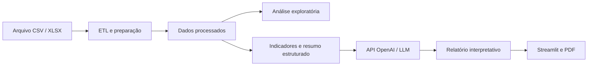

# Análise Térmica Industrial com LLM

**Aplicação em Python e Streamlit que transforma indicadores de monitoramento térmico industrial em análises e relatórios interpretativos com apoio de um modelo de linguagem (LLM).**

> Projeto de portfólio desenvolvido a partir de um sistema acadêmico de monitoramento do pré-aquecimento de água industrial.

## 1. Contexto e problema

O monitoramento de pré-aquecimento de água industrial produz registros de temperatura, vazão, energia e estados operacionais. Esses dados precisam ser tratados e contextualizados para apoiar a análise do desempenho térmico e a identificação de inconsistências.

A proposta é conectar **engenharia de dados, análise exploratória e IA generativa** em um único fluxo, sem atribuir ao LLM a responsabilidade pelos cálculos numéricos.

## 2. O que a aplicação implementa

- **ETL:** importação de arquivos CSV ou XLSX e preparação das leituras com Python e Pandas.
- **Análise exploratória:** consulta de indicadores, comportamento das variáveis e filtros por período.
- **Interpretação com IA:** envio de um resumo estruturado dos indicadores à API da OpenAI para elaboração de relatórios.
- **Relatórios:** formatos técnico, executivo e acadêmico, com exibição no Streamlit e exportação em PDF.

**Demonstração:** a amostra sintética cobre o ETL, a exploração e a preparação dos três relatórios. Os testes usam uma resposta simulada para verificar a geração e a exportação sem chamada externa.

## 3. Arquitetura



Os indicadores são processados em Python; o LLM recebe os dados consolidados e gera **interpretação em linguagem natural**. A saída do modelo pode conter erros e deve ser revisada antes do uso para decisões operacionais.

## 4. Tecnologias

| Tecnologia | Aplicação |
| --- | --- |
| Python | Processamento e lógica da aplicação |
| Pandas | Preparação de dados e indicadores |
| Streamlit | Interface e navegação |
| Plotly | Visualizações da análise exploratória |
| OpenAI API | Geração de relatórios interpretativos com LLM |
| ReportLab | Exportação de relatórios em PDF |

## 5. Organização do código

| Arquivo | Responsabilidade |
| --- | --- |
| `streamlit_app.py` | Entrada da interface e navegação entre as páginas |
| `etl_monitoramento.py` | Upload e preparação da base de dados |
| `function_monitoramento.py` | Funções auxiliares, tratamento de dados e PDF |
| `exploratoria_monitoramento.py` | Análise exploratória e visualizações |
| `inteligencia_monitoramento.py` | Indicadores, construção do contexto e exibição do relatório |
| `integracao_openai.py` | Configuração e chamada à Responses API com mensagens de erro controladas |
| `prompts/analise_termica.md` | Instruções compartilhadas pelos três tipos de relatório |
| `requirements.txt` | Dependências do ambiente Python |

## 6. Execução local (Windows / PowerShell)

Use Python 3.11. A geração de relatórios com IA requer uma chave de API e um modelo disponível para o projeto na OpenAI.

```powershell
# Clonar o repositório
git clone https://github.com/KoerichJ/analise-termica-llm.git
cd analise-termica-llm

# Preparar o ambiente
py -3.11 -m venv .venv
.\.venv\Scripts\Activate.ps1
python -m pip install -r requirements.txt

# Criar configuração local (não publicar credenciais)
if (-not (Test-Path .env)) { Copy-Item .env.example .env }
# Preencha OPENAI_API_KEY e OPENAI_MODEL no arquivo .env para usar IA

# Iniciar a aplicação
python -m streamlit run streamlit_app.py
```

Na interface, importe e processe uma base pela página **ETL** antes de acessar **Análise Exploratória** ou **Relatório com IA**. A aplicação utiliza os dados processados armazenados na sessão do Streamlit.

Para demonstrar o fluxo, importe `data/amostra_leituras.csv` no ETL com o fuso padrão, clique em **Processar dados** e abra as páginas de análise e relatório. A exploração e o resumo estatístico funcionam localmente, sem chave. Consulte o esquema, os fusos e as métricas em [Dados de exemplo](data/README.md).

A variável `OPENAI_MODEL` seleciona o modelo. O exemplo usa [GPT-6 Luna, compatível com a Responses API](https://developers.openai.com/api/docs/models/gpt-6-luna). O botão **Gerar relatório com IA** envia o resumo consolidado. Para testar a conexão isoladamente, `python teste_openai.py --executar` faz uma chamada real que pode gerar cobrança. O comando abaixo roda os testes locais.

```powershell
python -m unittest discover -s tests -v
```

## 7. Uso responsável da IA

- Os cálculos são realizados pela aplicação; o modelo atua na interpretação dos resultados fornecidos.
- As respostas são geradas a partir de contexto estruturado, não de uma leitura independente dos sensores.
- Não publicar chaves da API, dados industriais sensíveis ou arquivos `.env`.
- Validar as conclusões geradas e distinguir dados medidos, estimativas e interpretações.
- Revisar relatórios antes de utilizá-los em qualquer decisão operacional.

## 8. Origem do projeto

Este repositório reúne a camada de análise de dados e IA construída a partir do **TCC de monitoramento térmico industrial**. O projeto-base contempla a aquisição e o monitoramento de variáveis do pré-aquecimento de água; o código e a infraestrutura completos do TCC podem permanecer em repositório privado.

**Autor:** Jean Koerich  
**Contexto:** Portfólio acadêmico e profissional em Engenharia de Dados e Inteligência Artificial aplicada.
